# midexam
#    智慧多模式果汁機
以 NUCLEO-G474RE 模擬一台能依食材自動切換攪拌模式的智慧果汁機
##    1.情景故事
目的是解決使用者**不了解食材需要攪拌多久**，或是**食材辨認錯誤導致攪拌過度或攪拌不足**的問題  
並利用**蜂鳴器和燈光**使操作更直觀  
當我輸入 **banana** 後果汁機進入香蕉模式，**黃燈閃爍，馬達攪打**  
如果馬達阻力感測器感測到**阻力異常（使用按鈕按一下模擬）**，馬達停止，**停止燈亮**  
或攪拌時間到達（10 秒）馬達停止，停止燈亮  
當我輸入 **wattermalon** 後果汁機進入西瓜模式，**綠燈閃爍，馬達攪打**  
如果馬達阻力感測器感測到**阻力異常（使用按鈕在 500ms 內連按兩下模擬）**，馬達停止，**停止燈亮**  
或攪拌時間到達（10 秒）馬達停止，停止燈亮  
  
##    2.腳位對照與功能解釋  
1.使用LPUART1(Baud Rate：115200 , 8N1)(PA2 PA3)在pyserial終端機中輸入文字  
當在**終端機輸入文字"banana"代表放入香蕉，進入香蕉模式**  
**輸入"wattermalon"代表放入西瓜，進入西瓜模式**  
PA2(LPUART1_TX)用來傳送訊息到電腦，PA3(LPUART1_RX)用來接收水果指令  
2.使用TIM3 (PWM Generation CH4)(PC9)(PSC：169 ,ARR：999 ,1kHz)  
作為蜂鳴器使用，代表馬達轉動  
3.GPIO_Output (PC6 PC7 PC8)作為燈號使用  
PC6黃燈代表香蕉模式、PC7綠燈代表西瓜模式、PC8紅燈代表停止燈  
4.GPIO_EXTI11(PA11)(Pull-up)中斷程式，作為模擬馬達阻力感測的按鈕  

--MX設定--  
5.(NVIC EXTI line[15：10] ☑ LPUART1 global interrupt ☑)  
6.(SYS Debug Serial Wire)  
7.(Connectivity Mode Asynchronous)  
8.(TIM3 Channel4 PWM Generation CH4，Prescaler 169，Counter Period 999)  

--Pyserial設定--  
9.(CMD python -m serial.tools.miniterm --echo COM(你的port號) 115200)  
 
##    3.驗收條件與結果  
1.打開CMD -> Pyserial 輸入banana | 進入香蕉模式，黃燈閃爍、蜂鳴器呼吸鳴叫（馬達攪打）☑  
2.香蕉模式按下按鈕一次 | 模擬阻力異常，馬達停止，黃燈及蜂鳴器關閉，紅燈（停止燈）亮起 ☑  
3.攪拌時間到達10秒 | 馬達自動停止，黃燈及蜂鳴器關閉，紅燈亮起 ☑  
4.在Pyserial 輸入wattermalon | 進入西瓜模式，綠燈閃爍、蜂鳴器呼吸鳴叫（馬達攪打）☑  
5.西瓜模式500ms內連按兩下 | 阻力異常，馬達停止，綠燈及蜂鳴器關閉，紅燈亮起 ☑  
6.西瓜模式只按一下 | 不會停止，表示阻力正常 ☑  
7.攪拌時間到達10秒 | 馬達自動停止，綠燈及蜂鳴器關閉，紅燈亮起 ☑  
8.停止後再輸入banana或wattermalon | 果汁機重新啟動對應模式 ☑  
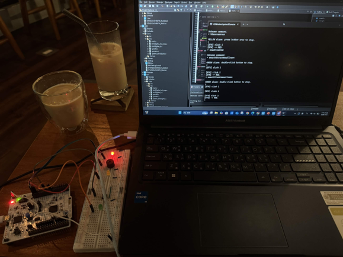  
##    4.智慧多模式果汁機技術勾選表  
☑GPIO輸出 黃燈(香蕉)PC6、綠燈(西瓜)PC7 代表食物，紅燈PC8 代表緊急停止  
☑GPIO輸入 按鍵PA11 代表果汁機阻力感測  

☑時脈功能 PLL 170MHz  

☑外部中斷 EXTI PA11 按鈕按下次數模擬阻力感測，阻力超過食材數值時停止  
☑NVIC功能 EXTI line[15:10]、LPUART1 global interrupt  
☑軟體去彈跳 按鈕不會錯誤動作  

☑UART 接收+環形緩衝 接收字串預設特定攪拌模式  
LPUART1 115200 8N1  
☑Pyserial 在CMD裡面輸入文字傳送給STM32  
python -m serial.tools.miniterm --echo  
COM10 115200  

☑Timer 定時中斷 攪拌時間到10秒自動停止  
☑PWM 設定蜂鳴器頻率(代表馬達轉速) TIM3_CH4 PC9  
##    5.腳位表  
本次應用到的腳位為  
GPIO_Output PC6 黃燈 香蕉模式攪拌時閃爍使用  
GPIO_Output PC7 綠燈 西瓜模式攪拌時閃爍使用  
GPIO_Output PC8 紅燈 停止燈，馬達停止時恆亮使用  
TIM3_CH4 PC9 蜂鳴器 代表馬達轉動，攪拌時呼吸鳴叫使用  
GPIO_EXTI11 PA11 按鈕 模擬馬達阻力感測器使用  
LPUART1_TX PA2 STM32 傳輸訊息給電腦用  
LPUART1_RX PA3 STM32 接收電腦傳來的水果指令用  
##    6.建置與執行  
**開發環境**：STM32CubeIDE  
**燒錄步驟**：開啟專案 → 點擊 Build (鎚子圖示) → 點擊 Run / Debug 燒錄至 NUCLEO-G474RE。  
**終端機設定與指令**：  
* 開啟終端機：`python -m serial.tools.miniterm --echo COM(你的com號) 115200`  
  * 支援指令：  
    * `banana`：進入香蕉模式，黃燈閃爍、蜂鳴器呼吸鳴叫，按鈕按 1 下停止。  
    * `wattermalon`：進入西瓜模式，綠燈閃爍、蜂鳴器呼吸鳴叫，按鈕 500ms 內連按 2 下停止。  
##    7.程式結構  
###    7-1.開頭宣告區  
程式一開始引入 `main.h`（HAL 函式庫）、`string.h`（用 `strcmp` 比對指令）與 `stdint.h`（固定長度整數型別）  
接著用 `AppMode_t` 定義狀態機的四種狀態：待機、香蕉模式、西瓜模式、紅燈停止  
再用 `#define` 設定腳位與參數：  
* **GPIO 輸出腳位**：紅燈 PC8、黃燈 PC6、綠燈 PC7  
* **按鈕（EXTI）腳位**：PA11  
* **PWM 蜂鳴器**：使用 TIM3 CH4，最大 duty 設為 50%（無源蜂鳴器在 50% 時最響）  
* **時間參數**：攪拌 10 秒、呼吸循環 3 秒、閃爍 250ms、防彈跳 50ms、雙擊時間窗 500ms  
* **緩衝區大小**：ring buffer 128 bytes、line buffer 32 bytes  

`hlpuart1` 與 `htim3` 是 CubeMX 產生的 UART 與 Timer 控制結構，HAL 函式透過它們操作週邊  
全域變數分成四組：  
* **ring buffer 變數**（`rxRing`、`rxHead`、`rxTail`）：存放 UART 收到的字元  
* **line buffer 變數**（`lineBuf`、`lineLen`）：把字元組合成一整行指令  
* **狀態機變數**（`g_mode`、`g_modeStartTick`）：記錄目前模式與模式開始的時間  
* **按鈕變數**（`btnEdgePending`、`btnClickCount` 等）：防彈跳旗標與按壓次數  

最後的函式原型宣告，讓 `main()` 可以呼叫寫在後面的函式  

###    7-2.main() 主程式  
`HAL_Init()` 初始化 HAL 函式庫，並啟動 SysTick 每 1ms 計時  
接著依序呼叫 `SystemClock_Config()` 設定 170MHz 系統時脈、`MX_GPIO_Init()` 設定 LED 與按鈕腳位、`MX_LPUART1_UART_Init()` 設定 UART、`MX_TIM3_Init()` 設定 PWM  
初始化完成後：  
* `HAL_TIM_PWM_Start()` 啟動 PWM，一開始 duty 為 0，蜂鳴器不響  
* `HAL_GPIO_WritePin()` 把所有 LED 關掉  
* `Button_DetectIdleLevel()` 偵測按鈕沒按時是 HIGH 還是 LOW  
* `HAL_UART_Receive_IT()` 啟動 UART 中斷接收，收到字元就進中斷  

進入 `while(1)` 主迴圈後，不斷輪流執行三個工作：`Line_Process()` 處理指令、`Button_Task()` 確認按鈕、`App_Task()` 控制燈號與蜂鳴器  

###    7-3.CubeMX 產生的初始化函式  
* `SystemClock_Config()`：**時脈設定**，HSI 16MHz ÷ 4 × 85 ÷ 2 = 170MHz  
* `MX_LPUART1_UART_Init()`：**UART 設定**，鮑率 115200、8 位元資料、無同位、1 停止位元  
* `MX_TIM3_Init()`：**PWM 設定**，PSC 169、ARR 999，170MHz ÷ 170 ÷ 1000 = 1kHz，CH4 設為 PWM1 模式  
* `MX_GPIO_Init()`：**GPIO 與 EXTI 設定**，PC6、PC7、PC8 設為推挽輸出，PA11 設為上升緣中斷加上拉，並在 **NVIC** 開啟 EXTI15_10 中斷（優先權 1）  

###    7-4.功能函式  
**UART 與緩衝區**  
* `UART_Print()`：UART 傳送，把文字送到電腦終端機  
* `RxRing_Put()`：ring buffer 寫入，UART 中斷收到的字元放進緩衝區  
* `RxRing_Get()`：ring buffer 讀出，主迴圈從緩衝區取出字元  
* `HAL_UART_RxCpltCallback()`：UART 接收中斷，每收到 1 個字元就存進 ring buffer，並重新啟動接收  
* `HAL_UART_ErrorCallback()`：UART 錯誤處理，發生錯誤時清除旗標並重新開始接收  
* `Line_Process()`：line buffer 處理，把字元組成一行，按 Enter 後送去比對指令，也處理 Backspace 與回顯  
* `Command_Handle()`：指令判斷，比對是 `banana` 還是 `wattermalon`，進入對應模式  

**攪拌模式控制**  
* `App_StartMode()`：進入模式，關燈、蜂鳴器歸零、記錄開始時間  
* `App_EnterRed()`：停止動作，紅燈恆亮、其他燈關閉、蜂鳴器停止，並印出停止原因  
* `App_Task()`：模式運作，LED 每 250ms 閃爍，**用 PWM 改變 duty 讓蜂鳴器呼吸鳴叫**（3 秒一循環），並判斷是否滿 10 秒  

**按鈕處理**  
* `Button_DetectIdleLevel()`：開機取樣 16 次，判斷按鈕閒置電位  
* `HAL_GPIO_EXTI_Callback()`：EXTI 外部中斷，按鈕產生上升緣時記錄時間  
* `Button_Task()`：軟體防彈跳，按鈕穩定 50ms 才算一次有效按壓  
* `Button_OnClick()`：按壓次數判斷，香蕉模式按 1 下停止，西瓜模式 500ms 內按 2 下停止  

**錯誤處理**  
* `Error_Handler()`：初始化失敗時關閉中斷並停在這裡，方便除錯
##    8.實作照片與講解
###    8-1.MX設定  
8-1-1.打開STM32CubeMX 設定以下腳位：  
PA11：GPIO_EXTI11 | PC9：TIM3_CH4  
PC8：GPIO_Output | PC6：GPIO_Output  
PC7：GPIO_Output | PA2：LPUART1_TX  
PA3：LPUART1_RX  
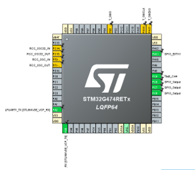  
8-1-2.點選MX左方"System Core"下方的"SYS"  
打開後點擊"Debug"的框  
選擇"Serial Wire"  
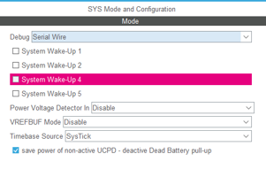  
8-1-3.點選MX左方"Timers"下方的"TIM3"  
打開後點擊"Channel 4"的框  
選擇"PWM Generation CH4"  
下方的Prescaler 設定為169  
Counter Period 設定為999  
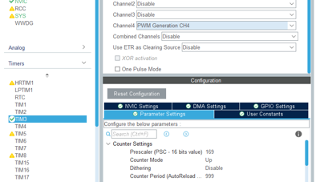  
8-1-4.點選MX左方"Connectivity"下方的"LPUART1"  
打開後點擊"Mode"的框 選擇"Asynchronous"  
下方"Baud Rate"改成"115200 Bit/s"  
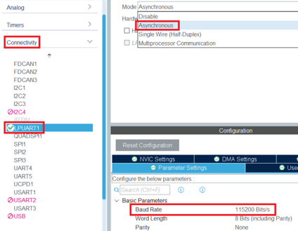  
8-1-5.點選MX左方"System Core"下方的"NVIC"  
將"EXTI line[15：10] interrupts"打勾  
並且將"Preemption Priority"調整為1  
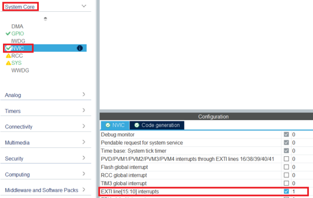  
###    8-2實體配線  
8-2-1.下圖為本次使用接腳的接腳圖，橘色框是GPIO_Output(PC6,PC7,PC8)  
藍色框是GPIO_EXTI(PA11)、紫色框是TIM3_CH4(PC9)  
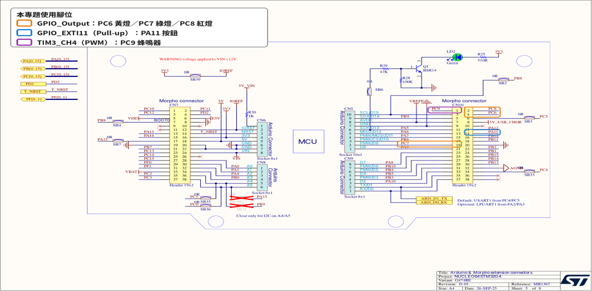  
8-2-2.此頁為接腳實體配線，白線為GND，接到麵包板右邊的負極(藍線)電源軌  
藍線(PC8)接紅燈、紅線(PC6)接黃燈、橘線(PC7)接綠燈  
綠線(PC9)接蜂鳴器、灰線(PA11)接按鈕  
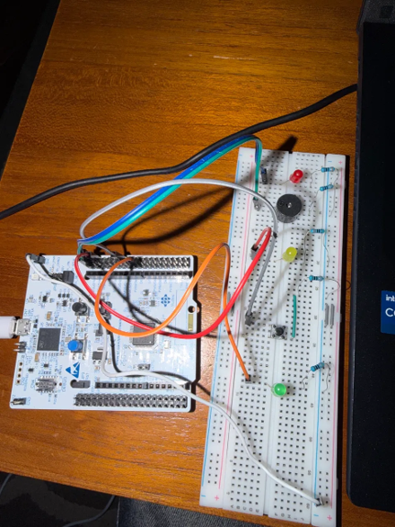  
###    8-3實機操作  
8-3-1.將程式燒錄進STM32後，打開電腦的"裝置管理員"  
查看下方的連接埠，確認自己的STM32在COM幾(此裝置為COM10)  
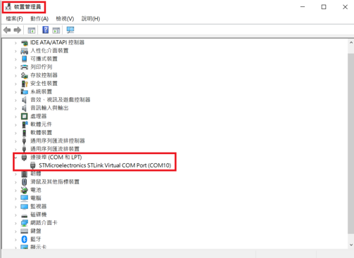  
8-3-2.打開"CMD"後輸入以下字元用來搭建通訊連接  
"python -m serial.tools.miniterm --echo COM10 115200"  
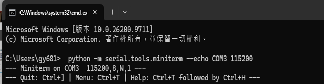  
8-3-3.在CMD輸入「banana」並按 Enter，黃燈開始閃爍，每 0.25 秒亮滅切換一次  
同時蜂鳴器開始響，音量每 3 秒由小變大、再由大變小，不斷循環  
這時按一下按鈕，黃燈熄滅、蜂鳴器停止，紅燈恆亮  
如果都沒按按鈕，10 秒後黃燈熄滅、蜂鳴器停止，紅燈恆亮  
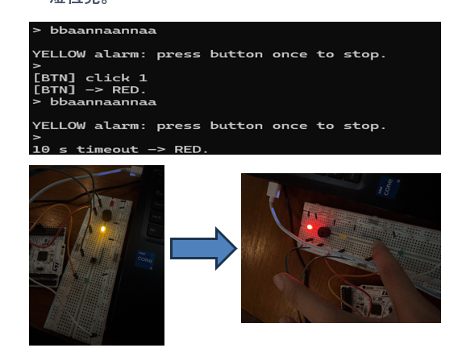  
8-3-4.在CMD輸入「wattermalon」並按 Enter，綠燈開始閃爍，蜂鳴器一樣以每 3 秒一循環的方式忽大忽小地響  
這時必須在 0.5 秒內連按兩下按鈕，綠燈才會熄滅、蜂鳴器停止，紅燈恆亮  
只按一下，或兩下間隔超過 0.5 秒，綠燈會繼續閃、蜂鳴器會繼續響  
如果都沒有成功連按兩下，10 秒後綠燈熄滅、蜂鳴器停止，紅燈恆亮  
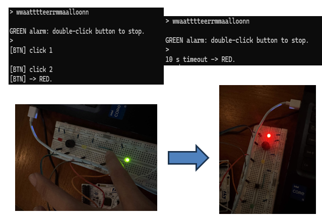  
##    9.AI使用說明  
使用AI撰寫程式 並協助了解程式內容 
  
##    10.已知限制  
1.本次以蜂鳴器的聲音代表馬達轉動、以按鈕模擬阻力感測器，與實際果汁機仍有差距  
實際果汁機需要使用馬達驅動電路，並透過電流感測或扭力感測判斷阻力是否異常  
2.目前只有香蕉與西瓜兩種模式，攪拌時間固定為10秒，尚未依食材設定不同時間  
3.指令必須完全拼對，例如輸入正確拼字"watermelon"會被判定為未知指令